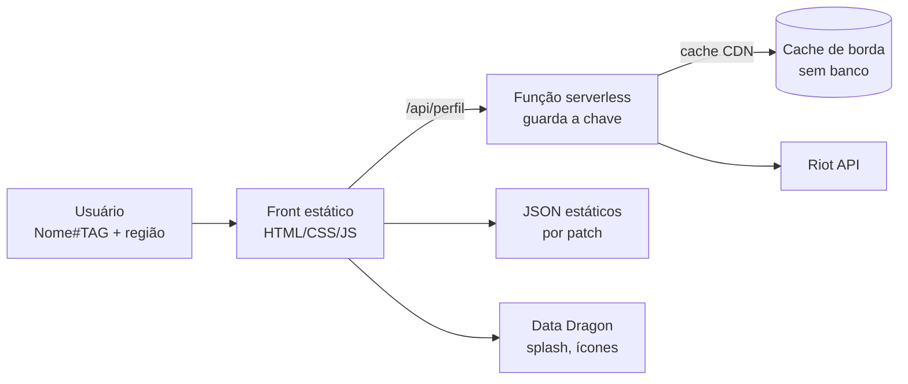

# Estudo de caso: landing pages dinâmicas por invocador (League of Legends)

> **Status:** estudo de viabilidade. O MVP (busca, landing dinâmica, templates por modo, persona,
> dicas e recomendações) já está implementado: veja o [README](../README.md).
> **Data:** outubro de 2026 (temporada 2026, patch 26.2x).

---

## 1. Resumo (TL;DR)

**Dá para fazer, e o diferencial existe.** O op.gg e o deeplol são, no fundo, *bancos de dados*
gigantes com uma interface por cima. Não temos como (nem queremos) competir nisso. Temos como
competir em **experiência**: uma página que se monta na hora, com a cara do campeão e do modo de
jogo da pessoa, e que fala com ela ("você é um *one-trick* de Ahri que joga de madrugada e perde
62% das partidas depois de duas derrotas seguidas").

Três condições definem o projeto:

1. **Precisamos de um backend mínimo.** A API da Riot não pode ser chamada direto do navegador
   (a chave ficaria exposta e a API não libera CORS). Basta uma função *serverless*, sem banco.
2. **Para abrir ao público, precisamos de uma *production key* aprovada pela Riot.** Com a chave
   de desenvolvimento ou a pessoal, o site inteiro aguenta só **3 a 4 buscas a cada 2 minutos**.
   Dá para construir e testar, mas não dá para lançar assim.
3. **"Não guardar nada" é viável se aceitarmos cache.** Partidas são imutáveis: uma vez baixadas,
   nunca mudam. Cache em CDN, JSONs estáticos gerados a cada patch e o `localStorage` do usuário
   resolvem tudo sem banco de dados.

O que **fica de fora**, por exigir banco/coleta em massa ou por política da Riot: tier list e
*winrate* global por campeão, *matchups*, *builds* "ótimas", autocomplete de nomes, histórico
completo instantâneo e qualquer estimativa de MMR (proibida pela Riot).

---

## 2. O que a ideia pede

| # | Requisito | Viável? |
|---|-----------|---------|
| R1 | Tela de busca pelo invocador | ✅ Sim, com **Riot ID** (`Nome#TAG`) + região, não pelo "nome de invocador" antigo |
| R2 | Landing page dinâmica com o campeão mais jogado | ✅ Sim. Splash art, cores, título e lore vêm de dados públicos |
| R3 | Landing diferente por modo de jogo mais jogado | ✅ Sim. Cada partida informa o `queueId` (Ranked, ARAM, Arena...) |
| R4 | Nada armazenado, tudo na hora | ⚠️ Sim, **com cache** (CDN + JSON estático). Sem cache, a cota da API acaba rápido |
| R5 | Dicas de como melhorar | ✅ Sim. Os dados por partida são riquíssimos (seção 9) |
| R6 | Campeões que combinam com o perfil | ✅ Sim, por similaridade de atributos (seção 10). A versão "quem joga X também joga Y" exige coleta offline |

---

## 3. De onde vêm os dados

### 3.1 Riot API (oficial, precisa de chave)

Roteamento: dados de conta e partidas usam o cluster **regional** (`americas.api.riotgames.com`
para o BR). Perfil, elo e maestria usam a **plataforma** (`br1.api.riotgames.com`).

| Endpoint | O que entrega | Uso na nossa página |
|----------|---------------|---------------------|
| `account-v1` by-riot-id | Riot ID → **PUUID** (identificador permanente) | Porta de entrada da busca |
| `summoner-v4` by-puuid | Ícone de perfil, nível | Avatar, nível |
| `league-v4` entries by-puuid | Elo Solo/Duo e Flex: tier, divisão, PDL, V/D, sequência de vitórias | Bloco competitivo |
| `champion-mastery-v4` by-puuid | Pontos e nível de maestria de **todos** os campeões, última vez jogado | **Campeão principal "histórico"** (rápido, sem baixar partidas) |
| `match-v5` ids by-puuid | Lista de IDs de partidas (até 100 por chamada; filtra por fila/tipo/data) | Amostra do histórico |
| `match-v5` match | Detalhe de uma partida: ~150 campos por jogador | Toda a análise (seção 3.3) |
| `match-v5` timeline | Minuto a minuto: ouro, XP, CS, posição; eventos (abates com coordenadas, wards, itens, skills) | Mapa de mortes, CS aos 10, ordem de skills |
| `spectator-v5` (por PUUID) | Partida em andamento | Selo "jogando agora" |
| `challenges-v1` | Desafios, título equipado, percentis | Conquistas e "você está no top X% em..." |
| `champion-v3` rotations | Rotação gratuita | Fundo animado da tela de busca |
| `league-v4` challenger/grandmaster/master | Ladder do topo | Opcional: benchmarks de alto elo |
| `clash-v1`, `lol-status-v4` | Clash, status do servidor | Opcional |

### 3.2 Dados estáticos (públicos, sem chave)

- **Data Dragon** (CDN oficial): `champion.json` em **pt_BR** (nome, título, lore, tags de
  classe, dificuldade, atributos), itens, runas, feitiços, ícones e imagens:
  - splash: `https://ddragon.leagueoflegends.com/cdn/img/champion/splash/{Campeao}_0.jpg`
  - loading: `https://ddragon.leagueoflegends.com/cdn/img/champion/loading/{Campeao}_0.jpg`
  - versões: `https://ddragon.leagueoflegends.com/api/versions.json`
- **Constantes de jogo**: `queues.json`, `maps.json`, `gameModes.json` em
  `https://static.developer.riotgames.com/docs/lol/`. Servem para traduzir `queueId` em modo.
- **CommunityDragon** (não oficial): emblemas de elo, brasões de maestria, assets em alta
  resolução. Ótimo, mas pode quebrar sem aviso.

### 3.3 O que vem dentro de uma partida (é aqui que mora o "algo a mais")

Cada participante de uma partida (`match-v5`) traz, além do básico (campeão, K/D/A, itens, runas,
posição, vitória):

- **Objeto `challenges`**, com dezenas de métricas já calculadas pela Riot: `kda`,
  `killParticipation`, `damagePerMinute`, `teamDamagePercentage`, `goldPerMinute`,
  `visionScorePerMinute`, `laneMinionsFirst10Minutes`, `soloKills`, `skillshotsDodged`,
  `controlWardsPlaced`, `dragonTakedowns`, `turretPlatesTaken` e outras.
- **Contagem de pings** por tipo (`enemyMissingPings`, `onMyWayPings`, `allInPings`...). Dá para
  fazer estatísticas divertidas ("você pingou **?** 340 vezes este mês").
- **Arena**: colocação final (`placement`), augments escolhidos, dupla/time (`playerSubteamId`).
- **Horário de início e duração** da partida: hábitos (madrugada, sessões longas, *tilt*).

O conteúdo das páginas, as dicas e a persona saem quase todos daqui, **sem precisar de dados de
outros jogadores**.

---

## 4. Restrições duras (são elas que definem a arquitetura)

### 4.1 Chaves e limites de requisição

| Chave | Validade | Limite | Pode ir a público? |
|-------|----------|--------|--------------------|
| Desenvolvimento | **Expira a cada 24 h** | 20 req/s e 100 req/2 min | ❌ |
| Pessoal | Não expira | 20 req/s e 100 req/2 min, sem aumento | ❌ Só para uso próprio ou comunidade pequena e privada |
| Produção | Não expira | Referência: ~500 req/10 s e ~30.000 req/10 min por região (varia com a aprovação; confirmar no portal) | ✅ Exige **registrar o produto** e passar por revisão da Riot (protótipo funcionando e descrição do produto; ter termos e política de privacidade publicados é recomendável) |

Os limites valem **por chave e por região, para o site inteiro**, não por usuário.

### 4.2 Nada de chamar a Riot pelo navegador

A chave não pode aparecer no front-end, e a API não responde com cabeçalhos CORS. Um site 100%
estático, sem nenhum backend, **não é possível**. A solução mínima é **uma função serverless**
(Cloudflare Worker, Vercel ou Netlify Functions) que guarda a chave, chama a Riot, agrega os dados
e devolve um único JSON de "perfil" para o front.

### 4.3 Riot ID em vez de nome de invocador

Desde o fim de 2023 a busca é por **`Nome#TAG`**. A Riot removeu em junho de 2025 os endpoints
baseados em *summonerId*/*accountId*, e o PUUID passou a ser a chave de tudo. Na prática:

- o usuário precisa digitar a TAG. Para jogadores do BR podemos tentar `#BR1` como padrão;
- **não existe busca parcial**, então não dá para ter autocomplete de nomes. O op.gg tem porque
  guarda milhões de contas no banco dele.

### 4.4 Políticas da Riot que nos afetam

- **Proibido**: calculadora ou estimativa de **MMR/elo oculto**, ou qualquer "ranking alternativo"
  que pareça oficial.
- **Proibido**: desanonimizar jogadores (ex.: revelar nomes na seleção de campeões) e **exibir
  Riot IDs antigos** de um jogador.
- **Obrigatório**: aviso de que o site não é endossado pela Riot ("Legal Jibber Jabber"). A Riot
  pode derrubar projetos de fãs a qualquer momento.
- **Monetização** (se um dia houver): precisa ter versão gratuita; conteúdo pago tem que ser
  "transformativo"; nada de cripto/blockchain.
- **Identidade visual**: o produto não pode imitar os produtos da Riot em estilo ou função.
  Atenção: "landing page de campeão" é exatamente o que o site oficial da Riot tem, então a nossa
  precisa ter **identidade própria**, sem copiar o layout oficial.

### 4.5 Mudanças recentes que importam

- **Junho/2025**: remoção dos endpoints por *summonerId*/*accountId*. Tudo passa a ser por PUUID.
- **Patch 26.21 (adiado do 26.20)**: replays (`.rofl`) passam a ser privados e sites de terceiros
  perdem o download. **Não nos afeta**, porque não usamos replays, mas mostra que a Riot está
  fechando o acesso de terceiros em 2026. Convém não depender de nada "cinzento".
- **Arena na temporada 2 de 2026** ganhou eventos rotativos, incluindo um formato **6 times de 3**
  no lugar de 8 duplas. O template de Arena tem que ler colocação e tamanho de time dos dados, sem
  assumir "duplas".
- **ARAM: Mayhem** deixou de ser marcado como modo temporário (as fontes divergem se já é
  permanente). É um bom candidato a template próprio.

---

## 5. Matriz: o que dá e o que não dá

| Funcionalidade | Situação | Por quê / como |
|----------------|----------|----------------|
| Busca por Riot ID + região | ✅ | `account-v1` |
| Elo, PDL, V/D (Solo e Flex) | ✅ | `league-v4` |
| Campeão principal (histórico) | ✅ instantâneo | Maestria |
| Campeão principal (atual) | ✅ | Últimas N partidas |
| Modo mais jogado | ✅ | `queueId` das últimas N partidas |
| Role principal | ✅ em Summoner's Rift | `teamPosition`. Vem vazio em ARAM e Arena |
| Estatísticas pessoais (KDA, CS, visão, dano, KP...) | ✅ | `match-v5` + `challenges` |
| Mapa de mortes, CS aos 10, ordem de skills | ✅ custa +1 chamada/partida | `timeline` |
| Hábitos (horário, sessões, *tilt*) | ✅ | Horário e resultado das partidas |
| Persona/arquétipo do jogador | ✅ | Regras sobre as estatísticas (seção 8.3) |
| Dicas de melhoria comparando com ele mesmo | ✅ | Vitórias × derrotas, campeão × campeão |
| Dicas comparando com "jogadores do seu elo" | ⚠️ | Precisa de referência: valores manuais ou coleta offline em JSON |
| Recomendação de campeões por atributos | ✅ | JSON de atributos por campeão |
| Recomendação "quem joga X também joga Y" | ⚠️ | Exige coleta offline (fase 3) |
| Partida ao vivo | ✅ | `spectator-v5` |
| Card/imagem para compartilhar | ✅ | Gerada na hora, sem armazenar |
| URL compartilhável (`/br/Nome-TAG`) | ✅ | A página é remontada a cada acesso |
| Tier list, *winrate* global, *matchups*, *builds* do meta | ❌ | Exige milhões de partidas em banco: é o negócio do op.gg |
| Autocomplete de nomes | ❌ | Não existe busca parcial na API |
| Busca pelo nome de invocador antigo | ❌ | Substituído pelo Riot ID |
| Histórico completo e instantâneo | ❌ | Uma chamada por partida. Analisamos uma amostra (20 a 50) |
| MMR / elo oculto | ❌ | Proibido pela política |
| Elo de Arena/ARAM | ❌ | A API de ranqueada (`league-v4`) cobre Solo/Duo e Flex. Nesses modos usamos colocação e *winrate* |
| Dados do cliente (LCU), overlay em jogo | ❌ | Só app desktop, fora do escopo de um site |
| Replays | ❌ | Privados a partir do 26.21 |

---

## 6. "Sem banco de dados": é viável?

Sim, se separarmos *banco de dados* de *cache*:

| Camada | O que guarda | Duração | É banco? |
|--------|--------------|---------|----------|
| **JSON estático no repositório** | Campeões pt_BR, filas, paleta de cores por campeão, região/facção, atributos para recomendação, temas por modo, referências de desempenho | Regerado a cada patch (~2 semanas) por um script/GitHub Action | Não |
| **Cache de CDN** nas respostas da função | Partida por ID (**imutável**, cache "para sempre"); perfil por PUUID (1–5 min) | Expira sozinho | Não |
| **Memória da função** | Cache LRU curto entre chamadas próximas | Some quando a instância morre | Não |
| **Navegador do usuário** | Últimas buscas, preferências | Do usuário | Não (fica no dispositivo dele) |
| *(opcional)* KV (Cloudflare KV, Vercel Blob) | Partidas já baixadas | Configurável | Um "quase banco" sem gestão. Decidir se aceitamos |

Ganho prático: quando alguém reabre a página, ou quando dois amigos que jogaram juntos são
buscados, as partidas em comum saem do cache e **não gastam cota**. Não guardar dados pessoais em
servidor também simplifica a **LGPD** (ainda assim, convém publicar uma política de privacidade
antes de pedir a *production key*).

---

## 7. Arquitetura proposta

**Stack (decisão nossa):**

- **Opção A, mais próxima do que já fazemos:** front em HTML/CSS/JS sem framework + uma função
  (Cloudflare Worker ou Vercel Function). A landing é montada no navegador a partir do JSON de
  perfil. É simples e rápida de iterar, mas o SEO e o card de compartilhamento pedem um passo
  extra.
- **Opção B, framework:** Next.js ou Astro com renderização no servidor e *streaming*. Faz SEO,
  cards de compartilhamento e carregamento progressivo de forma nativa, com mais estrutura para
  manter.

Recomendo começar pela **A** no protótipo (fase 0/1) e reavaliar na fase 2.

### 7.1 Orçamento de uma busca

| Onda | Chamadas | Observação |
|------|----------|------------|
| 1 | `account-v1` → PUUID | 1 chamada, sequencial |
| 2 | summoner, league, maestria, ids de partidas, spectator, challenges | 6 chamadas em paralelo |
| 3 | detalhes das N partidas | N chamadas (20 por padrão) |
| 4 *(opcional)* | timelines | +N |
| **Total** | **~27 sem timeline, ~47 com** | |

**Capacidade sem cache:**

- chave de desenvolvimento/pessoal: **~3–4 buscas a cada 2 minutos para o site inteiro**;
- chave de produção (referência): **~100 buscas por minuto**, bem mais com cache.

**Latência estimada (validar na fase 0):** o tema do campeão pode aparecer em **~0,5 s** (ondas 1
e 2: a maestria já diz quem é o *main*), e a página completa em **~1–2 s**. A demora vira parte da
experiência (seção 8.4).

---

## 8. A experiência: como a landing se monta

A página é composta por **três camadas** sobrepostas, todas calculadas na hora.

### 8.1 Camada 1: tema do campeão

- **Hero** com a splash art, o nome e o título em pt_BR ("Ahri, a Raposa de Nove Caudas"),
  trecho da lore.
- **Paleta de cores** extraída da splash e aplicada ao site inteiro (variáveis CSS). Calculada
  **uma vez por patch** e salva em JSON, para não processar imagem a cada visita.
- **Região/facção** (Ionia, Noxus...) para fundos e tipografia temáticos. A Data Dragon não traz
  isso, então montamos um JSON próprio (~170 campeões, trabalho único).
- **Tom de voz** por classe (Assassino, Mago, Tanque...) nos textos da página.
- **Narrativa "histórico × atual"**: se o *main* da maestria for diferente do *main* recente,
  isso vira conteúdo ("Seu coração é de Yasuo, mas ultimamente você anda de Yone").

### 8.2 Camada 2: template por modo mais jogado

| Modo predominante | Conceito do template | Destaques |
|-------------------|----------------------|-----------|
| **Ranqueada Solo/Duo e Flex** | "Dossiê competitivo" | Emblema e PDL, desempenho por role, CS/visão/KP, evolução recente |
| **ARAM / ARAM: Mayhem** | "Caos na ponte" | Adaptabilidade (campeões aleatórios), dano e cura, *pool* gigante, momentos absurdos |
| **Arena** | "Gladiador" | Colocação média, augments favoritos, parceiros de time, taxa de 1º lugar |
| **Normal / Swiftplay** | "Casual" | Diversão, campeões testados, parceiros frequentes |
| **Modos rotativos (URF etc.)** | "Evento" | Template leve e divertido |

O `queueId` é traduzido em modo pelo `queues.json`. Dentro de cada template, o conteúdo ainda
varia pelo campeão (camada 1) e pela persona (camada 3).

### 8.3 Camada 3: persona do jogador (estilo "Spotify Wrapped")

Regras simples sobre as estatísticas geram arquétipos que dão personalidade à página:

| Persona | Regra (exemplo) |
|---------|-----------------|
| *One-trick* | > 60% das partidas com o mesmo campeão |
| Camaleão | ≥ 10 campeões diferentes em 20 partidas |
| Carregador | `teamDamagePercentage` médio > 30% |
| Guardião da visão | `visionScorePerMinute` acima da referência da role |
| Kamikaze | Muitas mortes **e** alta participação em abates |
| Fazendeiro | CS/min acima da referência |
| Coruja | Maioria das partidas entre 0h e 5h |
| Maratonista | Sessões de 5+ partidas seguidas |
| Rei do "?" | Muitos `enemyMissingPings` |
| Duelista | Muitos `soloKills` |

As regras ficam num JSON e podem ser ajustadas sem mexer no código.

### 8.4 O carregamento como experiência

Em vez de *spinner*, a página **se constrói diante do usuário**: (1) achou a conta → ícone e
nível; (2) maestria → a splash entra e as cores do site mudam; (3) partidas → as seções vão
aparecendo. É um efeito de "seleção de campeão". O tempo de espera passa a ser parte do show.

### 8.5 Compartilhamento

- URL própria (`/br/Nome-TAG`) que remonta a página a cada acesso, sem nada salvo.
- Card de imagem gerado na hora (persona + campeão + elo) para redes sociais. Esse tende a ser o
  motor de divulgação.

---

## 9. "Como melhorar": motor de dicas

Três níveis, do mais barato ao mais caro:

1. **Comparação consigo mesmo** (sem dados externos, já no MVP):
   - *winrate* por campeão: "64% de Ahri contra 38% de Yasuo, vale focar";
   - *tilt*: *winrate* depois de 2 derrotas seguidas comparado ao geral;
   - horário: desempenho por faixa de horário;
   - duração: vence jogos curtos e perde longos? Sugere campeões de *early*;
   - vitórias × derrotas: o que muda (visão, mortes antes dos 10 min, objetivos).
2. **Comparação com referências por role/elo:**
   - **v1:** valores de referência manuais (ex.: CS/min alvo por role), simples e aproximados;
   - **v2:** `benchmarks.json` gerado por uma **coleta offline** (script que baixa uma amostra de
     partidas por elo e calcula medianas), rodado a cada patch e commitado no repositório. É o
     "arquivo JSON" no lugar do banco. Exige *production key* para ter volume.
3. **Narrativa com IA (opcional):** enviamos o **resumo já calculado** (não os dados brutos) para
   um LLM, que escreve o diagnóstico em pt-BR no tom da persona. Custa centavos por geração,
   acrescenta segundos (com *streaming* o texto aparece aos poucos) e precisa de regras para não
   inventar números.

Cada dica é uma regra em JSON (`condição → mensagem → prioridade`), e a página mostra as 3 a 5
mais relevantes.

---

## 10. "Campeões que combinam com você": recomendação

**Por atributos (viável no MVP, sem dados externos):**

1. Cada campeão ganha um vetor de atributos: classe (tags da Data Dragon), dano AD/AP,
   corpo a corpo/à distância (`attackrange`), dificuldade (`info.difficulty`) e, num JSON
   curado por nós, mobilidade, controle de grupo, *engage*, *poke*, *scaling* e roles.
2. O perfil do jogador é a média dos vetores dos campeões que ele joga, ponderada por partidas
   e desempenho.
3. Recomendamos os campeões mais próximos que ele **ainda não joga**, filtrados pela role
   principal, com explicação: "porque você vai bem de Ahri e Lux, magos de *burst* com
   mobilidade, experimente Syndra".
4. Dá para cruzar com os pontos fortes: muita visão → suportes de *engage*; vence jogos curtos
   → campeões de *early*.

**Por comportamento coletivo ("quem joga X também joga Y"):** precisa de dados agregados de
muitos jogadores, viável só com coleta offline gerando um JSON de coocorrência (fase 3).

> Custo escondido: o JSON de atributos curados (~170 campeões × ~8 atributos) é trabalho
> manual de algumas horas, que pode ser acelerado com IA e revisão humana. Ele precisa ser
> atualizado quando sai campeão novo ou rework.

---

## 11. Riscos

| Risco | Impacto | Mitigação |
|-------|---------|-----------|
| *Production key* negada ou demorada | Não lança ao público | Protótipo bem feito, termos, privacidade e aviso legal antes de pedir. Plano B: uso privado com chave pessoal |
| Erro 429 (limite) e instabilidade da API | Página quebra | Cache agressivo, respeitar `Retry-After`, degradar com elegância (mostrar o que já carregou) |
| Abuso/bots no nosso endpoint | Cota consumida | Limite por IP, Cloudflare Turnstile |
| Mudança de política da Riot | Funcionalidade some | Usar só API oficial e evitar fontes cinzentas (o caso dos replays mostra a tendência) |
| Fontes não oficiais (CommunityDragon) | Imagens quebram | *Fallback* para a Data Dragon |
| Patch a cada ~2 semanas | JSON desatualizado, campeão novo sem tema | GitHub Action que regenera os estáticos. Tema genérico de *fallback* |
| Dados "estranhos" | Estatística errada | Filtrar *remakes*, tratar `teamPosition` vazio, lidar com contas sem ranqueada ou com poucas partidas |
| Visual parecido com o site oficial | Violação de política | Identidade visual própria |

---

## 12. Roadmap sugerido

| Fase | Entrega | Chave |
|------|---------|-------|
| **0. Prova técnica** (1–2 dias) | Script que, dado um Riot ID, gera `perfil.json` (elo, maestria, 20 partidas, persona, 3 dicas). Mede a latência real | Dev |
| **1. MVP** | Tela de busca + landing com **tema do campeão** + persona + dicas "consigo mesmo" + 1 template (Ranqueada) + carregamento progressivo | Dev/Pessoal |
| **2. Templates e recomendação** | Templates ARAM, Arena e Normal; recomendação por atributos; cache CDN; URL compartilhável | Pessoal |
| **3. Lançamento público** | Registro na Riot (*production key*); termos e privacidade; card de compartilhamento; partida ao vivo; *benchmarks* por coleta offline; timeline (mapa de mortes); IA opcional | Produção |

---

## 13. Decisões para tomarmos

1. **Stack:** HTML/CSS/JS + função (opção A) ou framework (opção B)?
2. **Hospedagem:** Cloudflare (Workers + cache de borda) ou Vercel?
3. **Limite do "não guardar nada":** aceitamos cache de CDN e JSON estáticos? E um KV opcional?
4. **Público-alvo:** vamos atrás da *production key* (site público) ou fica privado por enquanto?
5. **Profundidade:** quantas partidas analisar por busca (20, 50 ou 100)? É velocidade contra
   precisão.
6. **Referências de desempenho:** valores manuais primeiro ou já planejar a coleta offline?
7. **IA para narrativa:** entra? Em qual fase?
8. **Modos no MVP:** só Ranqueada ou já ARAM/Arena?
9. **Regiões:** só BR no início ou todas?
10. **Identidade visual:** nome do projeto e linguagem visual própria (requisito de política).

---

## 14. Fontes

- Riot Developer Portal: [rate limiting](https://developer.riotgames.com/rate-limiting.html),
  [documentação LoL](https://developer.riotgames.com/docs/lol),
  [políticas gerais](https://developer.riotgames.com/policies/general),
  [termos da API](https://developer.riotgames.com/terms)
- [Política da API para League of Legends (Riot DevRel)](https://support-developer.riotgames.com/hc/en-us/articles/22698698001939-League-of-Legends)
- [Riot DevRel: remoção dos endpoints por SummonerID/AccountID (jun/2025)](https://x.com/RiotGamesDevRel/status/1932188110454235582)
- [Riot DevRel: de nomes de invocador para Riot ID](https://riotgames.com/en/DevRel/summoner-names-to-riot-id)
- [Legal Jibber Jabber (política de projetos de fãs)](https://www.riotgames.com/en/legal)
- Replays privados no 26.20/26.21: [Dot Esports](https://dotesports.com/league-of-legends/news/riot-delays-league-replay-changes-patch-26-21),
  [esports.gg](https://esports.gg/news/league-of-legends/patch-26-20-private-replays/)
- Arena na temporada 2 de 2026: [esports.gg](https://esports.gg/news/league-of-legends/lol-2026-season-2-arena-events-explained/),
  [Sheep Esports](https://www.sheepesports.com/articles/all-changes-coming-to-arena-in-league-of-legends-2026-season-2/en)
- [ARAM: Mayhem (wiki)](https://wiki.leagueoflegends.com/en-us/ARAM:_Mayhem)

> Observação: o portal da Riot não estava acessível do ambiente onde este estudo foi escrito.
> Os números de limite da chave de produção vêm de fontes secundárias e devem ser confirmados no
> portal ao registrar o produto.

